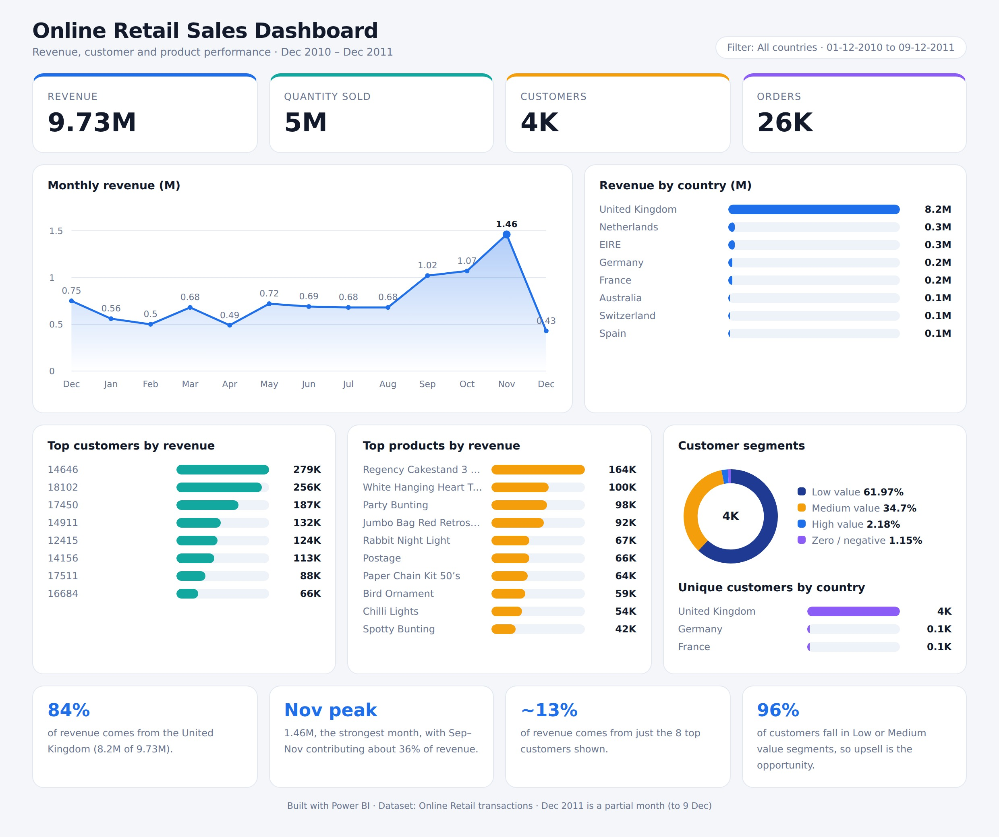

# Smart Inventory & Sales Analytics

An end-to-end retail analytics project that transforms raw transaction data into structured datasets, SQL-driven business insights, interactive Power BI dashboards, and API-accessible analytics.

**Tech Stack:** Python · Pandas · NumPy · MySQL · SQL · SQLAlchemy · Power BI · DAX · FastAPI

**GitHub Repository:** [Smart Inventory Analytics](https://github.com/navanthdev/smart-inventory-analytics)

---

## 1. Business Problem

Retail businesses generate large volumes of transaction data, but raw data often contains missing values, duplicate records, returns, and inconsistencies.

Without proper processing and analysis, it becomes difficult to:

- Identify top-performing products.
- Monitor monthly sales trends.
- Compare revenue across countries.
- Understand customer-level revenue and value segments.
- Convert historical transactions into useful business insights.

This project analyzes historical retail transactions to support data-driven sales and customer analysis.

## 2. Solution Overview

Built an end-to-end analytics workflow connecting data preparation, database integration, SQL analysis, business intelligence, and API development.

### Pipeline Architecture

```text
Raw Retail Dataset
        |
        v
Python Data Processing & ETL
(Pandas, NumPy)
        |
        v
Cleaned Transaction Dataset
        |
        v
MySQL Database
(SQLAlchemy)
        |
        v
SQL Business Analysis
(Aggregations, CTEs, Date Analysis)
        |
        +-------------------+
        |                   |
        v                   v
Power BI Dashboards     FastAPI Endpoints
(DAX & Visualization)   (Analytical Data Access)
```

The workflow supports historical retail sales analysis. It is not currently a real-time inventory management system.

## 3. Dataset

**Dataset:** UCI Online Retail  
**Original File:** `Online Retail.xlsx`

The dataset contains:

- Invoice numbers
- Product codes and descriptions
- Quantities
- Invoice dates
- Unit prices
- Customer IDs
- Countries

### Dataset Scale

| Metric | Value |
|---|---:|
| Cleaned transaction rows | 536,641 |
| Distinct invoices | 25,900 |
| Total recorded transaction revenue | 9,726,006.95 |

Revenue is calculated as quantity × unit price from the cleaned transaction records, including returns and negative-quantity rows.

## 4. Technology Stack

| Technology | Purpose |
|---|---|
| Python | Data processing and analysis |
| Pandas | Data cleaning and manipulation |
| NumPy | Numerical operations |
| Matplotlib | Data visualization |
| Seaborn | Statistical visualization |
| MySQL | Relational data storage |
| SQL | Business analysis and aggregations |
| SQLAlchemy | Database connectivity |
| Power BI | Interactive dashboards |
| DAX | Analytical measures |
| FastAPI | REST API development |
| Git & GitHub | Version control and project hosting |

## 5. Data Processing & ETL

The data preparation workflow includes:

1. Inspecting dataset structure, data types, and missing values.
2. Identifying and removing exact duplicate records.
3. Investigating missing customer IDs and product descriptions.
4. Examining returns, negative quantities, and unusual unit prices.
5. Calculating transaction revenue from quantity and unit price.
6. Preparing the cleaned dataset for database loading.
7. Loading the processed data into MySQL using Pandas and SQLAlchemy.
8. Validating database row counts and analytical totals against the cleaned dataset.

Data quality issues were investigated rather than automatically treating every negative quantity or missing customer ID as invalid.

## 6. SQL Business Analysis

SQL was used to explore business questions such as:

- What is the total recorded transaction revenue?
- How does revenue change month over month?
- Which products generate the highest revenue?
- Which countries contribute the most revenue?
- Which customers have the highest recorded revenue?
- How can customers be grouped by recorded revenue?

The analysis uses SQL aggregations, grouping, date-based analysis, and Common Table Expressions (CTEs).

## 7. Power BI Dashboards

### Sales & Revenue Analysis

The sales dashboard focuses on:

- Total recorded revenue
- Distinct invoice count
- Unique customer count
- Recorded quantity
- Monthly revenue trends
- Top 10 products by revenue
- Top countries by revenue
- Top customers by recorded revenue
- Date and country filters

### Customer Insights

The customer analysis focuses on:

- Customer distribution by country
- Customer revenue segments
- Customer-level revenue comparisons

Customer segment counts and percentages use distinct customer counts rather than summing customer IDs.

### Dashboard Screenshots

**Sales Dashboard**



## 8. FastAPI Endpoints

The application exposes endpoints for retrieving selected sales and product analytics.

| Method | Endpoint | Description |
|---|---|---|
| GET | `/test` | Test database connectivity |
| GET | `/products` | Retrieve the first 10 transaction rows |
| GET | `/product_summary` | Retrieve top 10 customer-product groups by revenue |
| GET | `/product/{stock_id}` | Retrieve a product transaction by stock code |
| GET | `/product_summary/{stock_id}` | Retrieve product quantity and revenue summaries |
| GET | `/sales_summary` | Retrieve overall sales metrics |
| GET | `/country_revenue/{country}` | Retrieve revenue for a country |
| GET | `/monthly_sales` | Retrieve monthly revenue |
| GET | `/country_summary` | Retrieve top 10 countries by revenue |
| GET | `/top_customers` | Retrieve top 10 customers by revenue |

## 9. Data Validation

The loaded MySQL table was validated against the cleaned dataset.

| Validation Metric | Expected Value |
|---|---:|
| Transaction rows | 536,641 |
| Distinct invoices | 25,900 |
| Total recorded transaction revenue | 9,726,006.95 |

## 10. Project Limitations

- The dataset contains historical retail transactions.
- It does not contain actual stock-on-hand quantities or reorder thresholds.
- The workflow does not currently provide real-time inventory updates.
- Automated scheduling and orchestration are not implemented.
- Revenue includes returns and negative-quantity rows unless a later filter is applied.

## 11. Future Improvements

Potential extensions include:

- Automating repeatable data ingestion and transformation.
- Adding pipeline logging, error handling, and data quality checks.
- Implementing incremental database loading.
- Scheduling data refreshes and monitoring pipeline failures.
- Integrating stock-on-hand and reorder-point data for inventory analysis.
- Expanding analytical KPIs and dashboard drill-through capabilities.
- Adding automated tests for API endpoints and data validation.

## 12. Project Outcome

Developed an integrated retail analytics workflow combining Python-based data preparation, MySQL storage, SQL business analysis, Power BI reporting, and FastAPI endpoints.

The project demonstrates practical experience across multiple stages of the analytics lifecycle, from data cleaning and database integration to business intelligence and API development.

## 13. Author

**Navanth Bhumireddy**

GitHub: [navanthdev](https://github.com/navanthdev)

---

*This project was developed for learning and portfolio demonstration using historical retail transaction data.*
